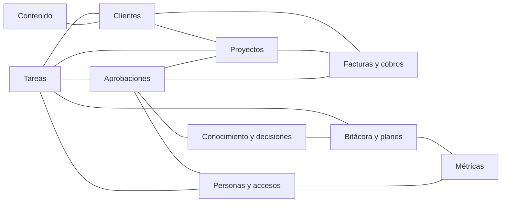

# Cerebro en Notion

El cerebro guarda el estado, las reglas y la memoria del negocio. Notion es la fuente de verdad, salvo leads y deals (Pipedrive) y conversaciones y consentimientos (ManyChat); la memoria de un chat nunca lo es. Lo que no quedó escrito no pasó. Pipedrive es dueño de todo lo anterior al pago y Notion de todo lo posterior: el evento «Pago recibido» crea el Proyecto desde la plantilla «Proyecto ganado» y la ficha en Clientes.

Aquí están las 10 bases (propósito, propiedades con el tipo sugerido de Notion, relaciones y quién las alimenta), las páginas, los tableros por rol, los permisos y el orden para construirlo. Fuente: [data/arquitectura.json](../data/arquitectura.json), campo `cerebro_notion`; el diseño general está en [01-arquitectura.md](01-arquitectura.md).

**Mapa visual interactivo del sistema:** https://claude.ai/artifact/FtyWRkr6M2jFp4Mnu5BFDN

> **La página «Irremplazables» de tu Notion no se toca.** Queda fuera del sistema: no se mueve, no se renombra, no se edita, no se archiva (aunque la regla de los agentes sea archivar en vez de borrar) y no se usa como página raíz ni como fuente de ninguna base. Como el conector de Notion actúa con tus permisos y llega a tus páginas privadas, la regla vale también para todos los agentes y rutinas.

**Estado al 10 de noviembre de 2026:** por construir. Según la ruta, las 10 bases entran en Fase 1 (diciembre de 2026). Cuando existan, sus enlaces se anotan en la sección «Enlaces del cerebro en Notion» del [CLAUDE.md raíz](../CLAUDE.md), que hoy dice «por definir».

## Índice

1. [Plan y límites](#plan-y-límites)
2. [Mapa de las 10 bases](#mapa-de-las-10-bases)
3. [Relaciones](#relaciones)
4. [Tipos de propiedad](#tipos-de-propiedad)
5. [Las 10 bases](#las-10-bases)
6. [Lo que no vive en estas bases](#lo-que-no-vive-en-estas-bases)
7. [Páginas](#páginas)
8. [Tableros por rol](#tableros-por-rol)
9. [Permisos](#permisos)
10. [Cómo se construye](#cómo-se-construye)

## Plan y límites

| Tema | Qué saber |
|---|---|
| Plan recomendado | Notion Plus: los invitados no ocupan asiento y, sin portales, bastan 1–2 miembros (tú y el asistente). Cuesta US$10 por miembro al mes en pago anual o US$12 mensual. Qué plan tienes hoy está por confirmar (pregunta abierta 6). |
| Cuándo pasar a Business | Solo si necesitas Notion AI completo o Custom Agents (US$20 o US$24 por miembro). Los Custom Agents consumen créditos a US$10 por cada 1,000 desde el 4 de mayo de 2026 y solo se compran en Business o Enterprise: con Plus no hay Custom Agents. Notion Business está en la lista de herramientas que esperan. |
| Límites de la API | En promedio 3 solicitudes por segundo por integración (con ráfagas; error 429 al pasarse) y máximo 100 resultados por página de consulta; Notion advierte que puede cambiar los límites por plan. Por eso los agentes leen por vistas guardadas. |
| Historial de versiones | 30 días en Plus, por confirmar. Es el historial con el que revisas 10 minutos cada lunes los cambios hechos por agentes. |
| Punto único de falla | Respaldo mensual fuera de Notion y fuera de GitHub (ver [Permisos](#permisos)), con restauración de prueba cada trimestre. |

## Mapa de las 10 bases

| Base | Para qué | Base núcleo de | También la nombran | La alimentan |
|---|---|---|---|---|
| [Tareas](#tareas) | Cola única de trabajo de todos los pilares. | automatizaciones | producto, clientes | Tú, el asistente, n8n y los Pilotos |
| [Conocimiento y decisiones](#conocimiento-y-decisiones) | Lo que todo agente lee antes de trabajar y todo colaborador consulta. | — | marketing, marca, ventas, producto, admin, legal | Tú decides; el Gabinete y el asistente registran |
| [Aprobaciones](#aprobaciones) | El único lugar donde un humano dice sí antes de que algo gaste dinero, contacte por primera vez, publique, toque impuestos, cambie precios o dé accesos. | automatizaciones | ventas | Los agentes con /pedir-aprobacion, tú y el asistente |
| [Bitácora y planes](#bitácora-y-planes) | Memoria episódica y auditoría. | automatizaciones | — | La skill /cierre y el Gabinete |
| [Personas y accesos](#personas-y-accesos) | Quién es quién, qué firmó y a qué tiene acceso. | legal | ventas | Tú y, desde enero, el asistente |
| [Clientes](#clientes) | Cada empresa cliente con sus datos fiscales, contrato, permisos y salud de la relación. | admin, clientes | marca, legal | n8n con «Pago recibido»; el asistente actualiza |
| [Proyectos](#proyectos) | Un registro por diagnóstico, proyecto o iguala, desde «Pago recibido» hasta el cierre. | producto, clientes | — | n8n con «Pago recibido» o «Diagnóstico pagado»; tú y el asistente; Arquitecto y Andamio desde Fase 2 |
| [Facturas y cobros](#facturas-y-cobros) | Cada CFDI y cada cobro esperado, de borrador a pagado. | admin | — | n8n crea el borrador; tú o el asistente timbran (Cobra desde Fase 2) |
| [Contenido](#contenido) | Una ficha por pieza, de la idea a su resultado. | marketing, marca | — | Tú, el editor o el asistente, y el Gabinete o Brújula |
| [Métricas](#métricas) | Los 9 KPIs del Tablero del CEO y pocos más por pilar, cada uno con su fuente exacta. | marketing | ventas | El Gabinete en Fase 1 y Brújula desde que haya 4 semanas de datos |

«Base núcleo de» y «También la nombran» salen del campo de bases de cada pilar en [01-arquitectura.md](01-arquitectura.md#los-8-pilares). Tareas, Aprobaciones y Bitácora y planes las usan todos los chats aunque su pilar no las nombre: /inicio lee la cola de Tareas, las Aprobaciones pendientes y las últimas 5 bitácoras del pilar; /pedir-aprobacion crea tarjetas en Aprobaciones; y /cierre deja la fila de la sesión en Bitácora y planes, actualiza Tareas y propone decisiones a Conocimiento y decisiones.

Ojo con el Gabinete: según quién alimenta cada base, también escribe en Métricas (números de los lunes), Contenido (Leads A/B) y Conocimiento y decisiones (decisiones de la junta), pero su regla de mínimo privilegio lo deja escribir solo en Bitácora y planes y en Tareas. Está por confirmar ([nota 4 de la tabla del README](../README.md#tabla-de-agentes-y-automatizaciones)); mientras un PR no lo resuelva, aplica lo más restrictivo: el Gabinete no escribe en esas tres bases, deja los números del lunes en el cuerpo de su fila «Plan del día» y las decisiones de la junta entran con /cierre como «Propuesta».

## Relaciones

Hay 16 relaciones entre bases distintas y 2 de una base consigo misma.

| # | Relación | Para qué | La nombra |
|---|---|---|---|
| 1 | Clientes y Proyectos | Cada proyecto es de un cliente. | Las dos bases |
| 2 | Clientes y Facturas y cobros | Cada CFDI sale con los datos fiscales de su cliente. | Las dos bases |
| 3 | Proyectos y Facturas y cobros | La factura de cada hito del proyecto. | Las dos bases |
| 4 | Tareas y Proyectos | Soporte y cambios del proyecto. | Las dos bases |
| 5 | Tareas y Clientes | Tickets de soporte del cliente. | Las dos bases |
| 6 | Tareas y Aprobaciones | Tareas en «Esperando aprobación». | Las dos bases |
| 7 | Tareas y Bitácora y planes | Las tareas de cada sesión y del plan del día (Top 3). | Las dos bases |
| 8 | Personas y accesos y Tareas | Checklists de alta y de baja. | Personas y accesos |
| 9 | Aprobaciones y Proyectos | Por ejemplo, el precio de un cambio de alcance. | Aprobaciones |
| 10 | Aprobaciones y Facturas y cobros | CFDI distintos a la propuesta aprobada. | Aprobaciones |
| 11 | Aprobaciones y Personas y accesos | Accesos. | Las dos bases |
| 12 | Aprobaciones y Conocimiento y decisiones | Cambios a páginas canónicas. | Las dos bases |
| 13 | Conocimiento y decisiones y Bitácora y planes | Decisiones propuestas. | Las dos bases |
| 14 | Bitácora y planes y Métricas | Revisiones. | Las dos bases |
| 15 | Personas y accesos y Métricas | Resultados semanales por setter. | Las dos bases |
| 16 | Contenido y Clientes | Casos con permiso. | Contenido |
| 17 | Conocimiento y decisiones consigo misma | «Reemplaza a»: la versión anterior de una página. | Conocimiento y decisiones |
| 18 | Contenido consigo misma | «Pieza madre»: de qué pieza sale cada derivada. | Contenido |

Al construir: crea cada par una sola vez como relación de dos sentidos (al crearla, activa que también se muestre en la otra base). Si la creas por separado desde las dos bases, te quedan dos relaciones distintas que no se sincronizan.

## Tipos de propiedad

La columna «Tipo sugerido» usa los nombres de los tipos de propiedad de Notion (en la app en español pueden aparecer traducidos). Donde el tipo no es obvio dice «Por definir» con las opciones.

| Tipo | Para qué sirve aquí |
|---|---|
| Título | El nombre de cada fila. Toda base tiene exactamente uno; si la arquitectura no le pone nombre, aquí dice «por definir». |
| Text | Texto libre corto. |
| Number | Cantidades. Los montos van en MXN con formato de moneda. |
| Select | Una opción de una lista cerrada. |
| Multi-select | Varias opciones de una lista cerrada. |
| Status | Estado de un flujo, con sus grupos (por hacer, en curso y hecho). |
| Date | Fecha, con hora o con rango si hace falta. |
| Person | Una persona con cuenta en tu Notion. Sin portales, en la práctica solo son tú y el asistente; para setters, clientes o la contadora se usa Select, Text o Relation. |
| Checkbox | Sí o no. |
| URL | Liga; los PDF y XML viven en Drive y aquí solo va su liga. |
| Email y Phone | Correo y teléfono. |
| Relation | Liga filas de dos bases (o de la misma base). |
| Rollup | Trae un dato de una base relacionada. Los números de leads y de métricas no se calculan con rollup: los escribe el Gabinete o Brújula. |
| Formula | Calcula a partir de otras propiedades (por ejemplo, días de atraso o semáforo). |
| Unique ID | Consecutivo automático con el prefijo que le pongas (por ejemplo C, para las piezas de Contenido). |

## Las 10 bases

De cada base: propósito, propiedades con su tipo sugerido, relaciones, quién la alimenta, qué agentes escriben ahí y lo que queda por definir al construirla. Los agentes que escriben salen de la columna «Puede escribir en» de la [tabla de agentes del README](../README.md#tabla-de-agentes-y-automatizaciones): si cambia allá, manda allá. Ningún agente borra: solo archiva.

### Tareas

**Propósito.** Cola única de trabajo de todos los pilares: la Bandeja de captura rápida, lo que n8n deja cuando un evento necesita criterio (así despierta a Claude), los tickets de soporte de clientes y los cambios de alcance.

| Propiedad | Tipo sugerido | Opciones o nota |
|---|---|---|
| Título | Título | Qué hay que hacer, en una línea. |
| Estado | Status | Bandeja / Por hacer / En curso / Esperando aprobación / Bloqueada / Hecha / Descartada |
| Pilar | Select | Los 8 ids: marketing, marca, ventas, producto, automatizaciones, admin, clientes, legal |
| Tipo | Select | Tarea / Soporte / Cambio de alcance / Evento para un agente |
| Prioridad | Select | P0 / P1 / P2 |
| Fecha límite | Date | |
| Dueño humano | Person | Tú o el asistente. |
| Agente | Select | Los nombres de la tabla de agentes del README. |
| Origen | Select | Tú, asistente, n8n, agente, setter, cliente o revisión |
| Pregunta CEO | Checkbox | Lo ambiguo se marca aquí en vez de adivinar. |
| ID externo | Text | Deal, PR, pieza o folio, para no duplicar. |
| Horas | Number | En soporte y cambios. |
| Iguala | Por definir | En soporte y cambios: marca que el ticket cuenta contra una iguala. Puede ser casilla o relación al Proyecto de tipo Iguala. |
| Precio | Number (MXN) | En cambios de alcance. |
| Aceptación por escrito | Por definir | En cambios: sin aceptación por escrito no hay trabajo extra. Puede ser casilla o fecha, con la liga al correo de aceptación. |

**Relaciones.** Proyectos, Clientes, Aprobaciones y Bitácora y planes. Personas y accesos también se liga con Tareas (checklists de alta y baja).

**Quién la alimenta**

- **Quién:** tú desde el celular (formulario de captura), el asistente, n8n y los Pilotos.
- **Cada cuándo:** en el momento.
- **Desde dónde:** app de Notion, flujos de n8n y chats.
- El Gabinete clasifica la Bandeja cada mañana.

**Agentes que escriben aquí.** Gabinete, Aduana (correcciones por responsable), Arquitecto (solicitud de cambio si la estimación supera lo vendido), Guardián (Cambio de alcance con precio) y Vigía (renovaciones y correcciones). Además, toda sesión con /cierre actualiza el Estado de sus Tareas y crea los pendientes nuevos, y /pedir-aprobacion pasa a «Esperando aprobación» la Tarea relacionada.

**Lo nombran los pilares.** automatizaciones (núcleo; Bandeja de captura y eventos que n8n deja para un agente), producto (issues de cliente y soporte con campos Horas e Iguala) y clientes (tickets de soporte y cambios de alcance con campos Horas e Iguala).

**Por definir al construir.** El tipo de Iguala y de Aceptación por escrito.

### Conocimiento y decisiones

**Propósito.** Lo que todo agente lee antes de trabajar y todo colaborador consulta: una sola versión de oferta y precios, reglas, voz, matrices, reglas fiscales y decisiones vigentes. Evita que un chat reabra lo que ya se decidió o cotice con precios viejos.

| Propiedad | Tipo sugerido | Opciones o nota |
|---|---|---|
| Título | Título | Nombre de la página o de la decisión. |
| Tipo | Select | Guía / Política / Playbook / Plantilla / Regla fiscal / Decisión |
| Pilar | Select | Los 8 ids |
| Estado | Status | Propuesta / Vigente / Reemplazada |
| Canónica | Checkbox | Solo tú la cambias. Cambiar una página canónica pide aprobación (tipo «Página canónica»). |
| Audiencia | Multi-select | Interno, setters, contadora, editor, clientes |
| Vigente desde | Date | |
| Revisar el | Date | |
| Reemplaza a | Relation | A la misma base: liga cada página con la versión que sustituye. |
| Decidió | Person | |

**Relaciones.** Aprobaciones (cambios a páginas canónicas) y Bitácora y planes, más la relación consigo misma «Reemplaza a».

**Quién la alimenta**

- **Quién:** tú decides; el Gabinete registra las decisiones de la junta del lunes y el asistente las reglas que dicta la contadora.
- **Cada cuándo:** al decidir, con 10 minutos de revisión de cambios en la junta del lunes (en lugar de un agente nocturno).
- **Desde dónde:** chats y correo de la contadora.

**Agentes que escriben aquí.** Enlace (reglas fiscales), Llavero (página «Cuentas críticas y vencimientos», privada y sin contraseñas), Escudo (página «Datos que guardamos») y Lupa (ejemplos para el Playbook; hoy lo haces tú). Toda sesión con /cierre propone aquí sus decisiones, siempre con Estado «Propuesta»: nunca las marca «Vigente» ni «Canónica». Matiz por resolver antes de encender el Gabinete: según quién alimenta esta base, registra las decisiones de la junta, pero su regla de mínimo privilegio lo deja escribir solo en Bitácora y planes y en Tareas (nota 4 de la tabla del README). Mientras se resuelve, el Gabinete no escribe aquí y las decisiones de la junta entran con /cierre en la sesión de chat donde se trabajen.

**Lo nombran los pilares.**

- marketing: Diccionario de métricas, fuentes y UTMs; Biblioteca de respuestas del bot.
- marca: Posicionamiento, Guía de voz, promesas prohibidas y pilares editoriales.
- ventas: Playbook, Diccionario comercial con etapas y motivos de pérdida, Plan de compensación y Programa de referidos.
- producto: página «Oferta y precios vigentes» con la sección Capacidad, estándares de código y checklist de salida a producción.
- admin: reglas fiscales escritas de la contadora y página «Obligaciones fiscales» con checklist mensual y anual.
- legal: páginas «Datos que guardamos», con versiones del aviso y bitácora ARCO, y «Cuentas críticas y vencimientos», privada y sin contraseñas.

### Aprobaciones

**Propósito.** El único lugar donde un humano dice sí antes de que algo gaste dinero, contacte por primera vez, publique, toque impuestos, cambie precios o dé accesos. Se aprueba por excepción: lo que coincide con algo ya aprobado no entra aquí.

| Propiedad | Tipo sugerido | Opciones o nota |
|---|---|---|
| Título | Título | Nombre de la propiedad por definir (la arquitectura no lo nombra). /pedir-aprobacion lo llena con qué se aprueba, en una línea y con el monto si hay. |
| Tipo | Select | Gasto / Primer contacto / Publicación / Impuestos / Precio o descuento / Comisiones / Acceso / Página canónica / Activar automatización / Plantilla de envío |
| Monto MXN | Number (MXN) | |
| Riesgo | Por definir | Select si fijas una escala de niveles; Text si va en una línea qué puede salir mal, que es lo que escribe /pedir-aprobacion mientras no haya escala. |
| Borrador exacto (vista previa) | Text | El texto o la liga exacta de lo que se va a ejecutar. |
| Última edición del borrador | Date (con hora) | Si el borrador cambió después de aprobar, la aprobación ya no vale. La registra quien edita el borrador: la propiedad automática de última edición de Notion cambia con cualquier cambio de la fila, incluida la aprobación misma. |
| Solicitada por | Select | Agente o persona. |
| Estado | Status | Pendiente / Aprobada / Rechazada / Vencida / Ejecutada / Falló |
| Aprobada por | Person | Tú o, desde enero, el asistente dentro de su límite. |
| Fecha de aprobación | Date | |
| Vence | Date (o Formula) | 48 h; sin decisión pasa a tu siguiente ventana, nunca a un puesto vacío. |
| Regla aplicada | Select | La regla de la Matriz de aprobaciones que aplica. |
| Id de ejecución | Text | Desde Fase 2, con el Portero. |
| Evidencia | Text o URL | Desde Fase 2: folio, id del mensaje o captura. |

**Relaciones.** Tareas, Proyectos, Facturas y cobros, Personas y accesos y Conocimiento y decisiones.

**Quién la alimenta**

- **Quién:** los agentes con /pedir-aprobacion y tú o el asistente al pedir algo; deciden tú y, desde enero, el asistente dentro de su límite.
- **Cada cuándo:** en las ventanas de 9:30 y 17:30.
- **Desde dónde:** chats y Notion móvil.
- El Portero registra la ejecución desde Fase 2.

**Agentes que escriben aquí.** Cualquier chat con /pedir-aprobacion y, en particular: Cierre (precio o descuento), Boca a Boca (lista, plantilla y costo), Guardián (precio del cambio), Boletín (borrador del correo y del mensaje del Canal), Altavoz (primer contacto), Cobra (CFDI distinto a la propuesta), Escudo (respuesta ARCO) y Portero (Ejecutada o Falló, con id de ejecución y evidencia).

**Lo nombran los pilares.** automatizaciones (núcleo) y ventas (precio y descuentos).

**Por definir al construir.** El nombre del título, el tipo y los niveles de Riesgo y los montos de la Matriz que usa «Regla aplicada». Además, la lista de propiedades no trae Pilar, y /inicio y la vista de cada pilar necesitan las aprobaciones de cada pilar: hoy /inicio las filtra por «Solicitada por» y por la Tarea relacionada. Si prefieres agregar una propiedad Pilar (Select con los 8 ids), actualiza /inicio por PR para que la use.

### Bitácora y planes

**Propósito.** Memoria episódica y auditoría: una fila por sesión de Piloto, por corrida con novedad, por plan del día, por revisión semanal y por cierre mensual del sistema.

| Propiedad | Tipo sugerido | Opciones o nota |
|---|---|---|
| Título | Título | Nombre por definir; la arquitectura no lo nombra (por ejemplo, fecha, agente y tipo). |
| Tipo | Select | Sesión / Corrida / Plan del día / Revisión semanal / Cierre mensual |
| Agente | Select | Los nombres de la tabla de agentes del README, más «Piloto» para las sesiones de chat (así lo escribe /cierre). |
| Pilar | Multi-select | Los 8 ids. Multi-select porque una sesión de un chat con dos pilares lleva los dos (así lo escribe /cierre). |
| Inicio y fin | Date (con hora y fecha de fin) | Una sola propiedad con rango. |
| Resultado | Select | OK / Parcial / Error |
| Resumen | Text | Máximo 10 líneas. |
| Top 3 | Text | En planes del día. |
| Bases leídas | Multi-select | Las 10 bases. |
| Bases escritas | Multi-select | Las 10 bases. |
| Enlace a la sesión | URL | |
| Horas de gestión del CEO | Number | En revisiones. |

**Relaciones.** Tareas, Conocimiento y decisiones (decisiones propuestas) y Métricas.

**Quién la alimenta**

- **Quién:** la skill /cierre al terminar cada sesión y el Gabinete (plan del día y revisión semanal).
- **Cada cuándo:** diario.
- **Desde dónde:** chats y la rutina de las 7:10.
- Las corridas sin novedad no escriben.

**Agentes que escriben aquí.** Toda sesión con /cierre, el Gabinete y Vigía (nota mensual).

**Lo nombran los pilares.** automatizaciones (núcleo).

**Por definir al construir.** El nombre del título.

### Personas y accesos

**Propósito.** Quién es quién, qué firmó y a qué tiene acceso: setters, editor, contadora, abogado, asistente, persona de confianza y freelancers. Base sensible: no se comparte con invitados ni se respalda en el repo.

| Propiedad | Tipo sugerido | Opciones o nota |
|---|---|---|
| Nombre | Título | |
| Rol | Select | Setter, editor, contadora, abogado, asistente, persona de confianza, freelancer |
| Estado | Status | Alta solicitada / Activo / Baja / Ex |
| Carta provisional firmada | Date | Fecha de firma. |
| Contrato definitivo firmado | Date y URL | Dos propiedades: fecha de firma y liga al PDF en Drive. |
| Herramientas con acceso y nivel | Text | Una línea por herramienta con su nivel. |
| Número desde el que atiende | Phone | Setters. |
| País | Select | |
| Régimen fiscal | Select | RFC y CLABE viven en la hoja de dinero, no aquí. |
| Checklist de alta y de baja | Plantilla de página o Tareas ligadas | Se ejecuta con el checklist de Llavero: baja en 24 h. |
| Prueba de alta aprobada | Checkbox | Setters: 5 conversaciones de práctica con la rúbrica antes de tomar leads reales. |
| Límite en la Matriz | Number (MXN) | Asistente. |
| Próxima revisión de accesos | Date | |

**Relaciones.** Tareas (checklists), Métricas (resultados semanales por setter) y Aprobaciones (accesos).

**Quién la alimenta**

- **Quién:** tú y, desde enero, el asistente.
- **Cada cuándo:** en cada alta o baja y en el checklist mensual.
- **Desde dónde:** Notion.

**Agentes que escriben aquí.** Notario (fecha y PDF del documento firmado) y Llavero (checklist y próxima revisión).

**Lo nombran los pilares.** legal (núcleo; carta y contrato como propiedades con el PDF en Drive) y ventas (ficha de cada setter: carta y contrato, número desde el que atiende, país y régimen).

**Por definir al construir.** Dónde quedan la fecha en que se pidió una baja y la fecha en que se ejecutó, para medir el KPI «bajas ejecutadas en 24 h o menos».

### Clientes

**Propósito.** Cada empresa cliente con sus datos fiscales, alta de proveedor, plazo real de pago, contrato, permisos y salud de la relación. Los leads no viven aquí: viven en Pipedrive; aquí entra quien pagó.

| Propiedad | Tipo sugerido | Opciones o nota |
|---|---|---|
| Razón social exacta | Título | Como en la Constancia de Situación Fiscal. |
| RFC | Text | Como en la Constancia. |
| Régimen fiscal | Select | |
| Código postal fiscal | Text | |
| Uso de CFDI | Select | |
| Correo de facturación | Email | |
| Contacto de cuentas por pagar | Text | |
| Constancia | URL | Liga a Drive restringido. |
| Fecha de la Constancia | Date | |
| ¿Retiene ISR o IVA? | Multi-select | ISR / IVA |
| Alta de proveedor: documentos | Text | Qué documentos pide el cliente. |
| Alta de proveedor: días | Number | |
| Alta de proveedor: estado | Select | Valores por definir. |
| Plazo real de pago | Number | Días. |
| Contrato marco firmado | Date y URL | Dos propiedades: fecha de firma y liga al PDF en Drive. |
| Permiso de uso | Multi-select | Por niveles: nombre, logo, cifras, video o anónimo. |
| PDF del permiso de uso | URL | El PDF firmado, en Drive. |
| Opt-in | Text | Copia de ManyChat (fecha, canal y versión). La fuente sigue siendo ManyChat. |
| Referido por | Text | Quién lo refirió. |
| Salud | Select | Verde / amarillo / rojo |

**Relaciones.** Proyectos, Facturas y cobros y Tareas. Contenido también se liga con Clientes (casos con permiso).

**Quién la alimenta**

- **Quién:** n8n la crea con «Pago recibido» usando los datos que pidió la propuesta (Constancia, uso de CFDI y correo de facturación); el asistente actualiza alta de proveedor, plazos y permisos.
- **Cada cuándo:** al cobrar y en cada hito.
- **Desde dónde:** formulario «Pago recibido» y correo.

**Agentes que escriben aquí.** Eco (respuestas y permiso de uso) y Notario (fecha y PDF del documento firmado).

**Lo nombran los pilares.** admin (núcleo; campos fiscales, alta de proveedor y plazo real de pago), clientes (núcleo; salud, permiso de uso por niveles y opt-in copiado de ManyChat), marca (propiedad «Permiso de uso» por niveles, con el PDF firmado en Drive) y legal (contrato marco y permiso de uso como propiedades).

**Por definir al construir.** Dónde quedan las respuestas de la encuesta de 2 preguntas (del 0 al 10 y por qué) que Eco escribe aquí; cómo se marca que ya se pidió el referido, para el KPI «clientes entregados con testimonio o caso con permiso y con referido pedido»; los valores del estado del alta de proveedor.

### Proyectos

**Propósito.** Un registro por diagnóstico, proyecto o iguala, desde «Pago recibido» hasta el cierre; nace de la plantilla «Proyecto ganado» y su checklist hace de traspaso entre venta, entrega, factura y post-venta.

| Propiedad | Tipo sugerido | Opciones o nota |
|---|---|---|
| Nombre | Título | Formato «Cliente – Proyecto». |
| Código de proyecto | Text | Para los bloques de Calendar con los que se miden las horas. |
| Tipo | Select | Diagnóstico / Proyecto / Iguala (y Capacitación si aplica) |
| Estado | Status | Por arrancar / Kickoff / En construcción / QA / Revisión del cliente / Garantía / Cerrado |
| Monto MXN sin IVA | Number (MXN) | |
| Hitos | Tabla o checklist dentro de la página | Monto, fecha y recordatorio de cada pago; el recordatorio vive en Google Calendar. Los hitos no son base aparte. |
| Fecha de «Pago recibido» | Date | |
| Fecha de kickoff | Date | |
| Checklist «Proyecto ganado» | Checkbox, una por paso (sugerencia) | Kickoff, cuentas a nombre del cliente, 3 métricas de línea base, factura de cada hito, comisión, acta, encuesta, testimonio y referido. Como propiedades, el Tablero del asistente puede filtrar lo pendiente. |
| Horas P50 | Number | |
| Horas P90 | Number | |
| Horas reales | Number | De los bloques de Calendar con el código del proyecto, que suma el Gabinete. |
| Repo | URL | Repo privado del proyecto, enlazado por Andamio. |
| Preview | URL | En la cuenta del cliente. |
| Setter | Por definir | Para su comisión. Puede ser Select con el nombre o relación a Personas y accesos (esa relación no está en la lista de la arquitectura). |
| Confidencialidad | Select | Niveles por definir. |

**Plantillas de la base.** «Proyecto ganado»: checklist de kickoff, recordatorio por cada pago de hito, reporte semanal, acta con aceptación tácita, encuesta, testimonio, referido y comisión. Si confirmas que vendes capacitación (flujo 7), el tipo Capacitación tiene su propia plantilla.

**Relaciones.** Clientes, Facturas y cobros y Tareas (soporte y cambios). Aprobaciones también se liga con Proyectos.

**Quién la alimenta**

- **Quién:** n8n la crea con «Pago recibido» o «Diagnóstico pagado»; tú y el asistente avanzan el checklist; Arquitecto y Andamio escriben desde Fase 2.
- **Cada cuándo:** en cada hito y cada viernes.
- **Desde dónde:** formulario «Pago recibido», chats y Calendar.

**Agentes que escriben aquí.** Arquitecto (brief técnico y estimación; el brief técnico v1 vive dentro de la ficha del Proyecto), Andamio (enlace al repo), Bienvenida (kickoff, checklist de accesos y línea base) y Entrega (checklist del hito).

**Lo nombran los pilares.** producto (núcleo; plantilla «Proyecto ganado» con hitos y cambios como checklist o Tareas dentro de cada Proyecto) y clientes (núcleo; tipos Diagnóstico, Proyecto, Iguala y, si aplica, Capacitación).

**Por definir al construir.** Las fechas de «QA aprobado» y de acta firmada de cada hito (para el KPI «días de QA aprobado a acta firmada o aceptación tácita»); las horas incluidas de cada iguala (para «horas de iguala usadas contra incluidas»); el criterio de «proyectos en riesgo» del Tablero del CEO; el tipo de Setter; los niveles de Confidencialidad y el formato del código de proyecto.

### Facturas y cobros

**Propósito.** Cada CFDI y cada cobro esperado, de borrador a pagado: el puente entre venta, proyecto, comisión y contadora.

| Propiedad | Tipo sugerido | Opciones o nota |
|---|---|---|
| Folio | Título | |
| UUID | Text | Folio fiscal del CFDI timbrado. |
| Tipo | Select | Ingreso / Complemento de pago / Nota de crédito |
| Estado | Status | Borrador / Por aprobar / Timbrada / Enviada / Pago parcial / Pagada / Cancelada |
| Método | Select | PUE o PPD, según la regla escrita de la contadora. |
| Forma de pago | Select | Valores por definir con la contadora. |
| Moneda | Select | |
| Tipo de cambio | Number | |
| Subtotal | Number (MXN) | |
| IVA | Number (MXN) | |
| Retenciones | Number (MXN) | |
| Total | Number o Formula | |
| Neto a recibir | Number o Formula | Cómo se calculan total y neto con retenciones: confírmalo con la contadora antes de volverlos fórmula. |
| Vencimiento | Date | |
| Días de atraso | Formula | Alimenta la cartera vencida por antigüedad (1–15, 16–30 y más de 30 días). |
| Folio de la propuesta | Text | |
| Deal de Pipedrive | URL | |
| lead_id | Text | |
| Medio de cobro | Select | SPEI / tarjeta / MSI |
| XML | URL | En Drive /Fiscal/AAAA/MM/Emitidas. |
| PDF | URL | En Drive /Fiscal/AAAA/MM/Emitidas. |

**Relaciones.** Clientes y Proyectos. Aprobaciones también se liga con Facturas y cobros.

**Quién la alimenta**

- **Quién:** n8n crea el borrador con «Pago recibido», con cada hito aceptado y el día 1 de cada iguala; tú o el asistente timbran en el portal o PAC (Cobra desde Fase 2) y marcan los pagos.
- **Cada cuándo:** en el momento.
- **Desde dónde:** formulario «Pago recibido», portal o PAC y Drive.

**Agentes que escriben aquí.** Cobra, desde Fase 2.

**Lo nombran los pilares.** admin (núcleo).

**Por definir al construir.** Una propiedad para el saldo, que Cobra registra junto con estado, UUID y días de atraso y no está en la lista; las fórmulas de total y neto; los valores de Forma de pago.

### Contenido

**Propósito.** Una ficha por pieza (madre o derivada) desde la idea hasta su resultado, con su palabra clave y su fuente.

| Propiedad | Tipo sugerido | Opciones o nota |
|---|---|---|
| Título | Título | Nombre por definir; la arquitectura no lo nombra (por ejemplo, el tema de la pieza). |
| ID | Unique ID | Prefijo C. La arquitectura usa el formato C-0001: confirma al construir que el consecutivo de Notion te sirve así o ajústalo. |
| Pieza madre | Relation | A la misma base. |
| Estado | Status | Idea / Aprobada / Guion listo / Grabada / En edición / Lista para publicar / Programada / Publicada |
| Pilar editorial | Select | Los pilares editoriales de la página Posicionamiento y Guía de voz. |
| Etapa del comprador | Select | Descubre / Compara / Decide |
| Origen | Select | Objeción / Pregunta repetida / Caso / Otra |
| Formato | Select | Opciones por definir. |
| Plataformas | Multi-select | Opciones por definir. |
| Gancho | Text | |
| CTA | Text | |
| Palabra clave | Select | Una de las 3–5 fijas de la oferta (por ejemplo DIAGNOSTICO o AGENTES). |
| URL con UTM | URL | Solo en piezas que van a pauta, con el UTM del Diccionario. |
| Link de bruto | URL | Carpeta 01_Bruto. |
| Link de editado | URL | Carpeta 02_Editado. |
| Usa IA generativa | Checkbox | |
| Música con licencia | Checkbox | |
| Permiso de terceros | Checkbox | |
| Leads A/B | Number | Lo escribe el Gabinete o Brújula cada semana; no es rollup. |

**Relaciones.** Contenido (pieza madre) y Clientes (casos con permiso).

**Quién la alimenta**

- **Quién:** tú en el bloque del viernes (ideas y aprobación), el editor o el asistente (estados) y el Gabinete o Brújula (resultados).
- **Cada cuándo:** semanal.
- **Desde dónde:** Notion y las carpetas de Drive.

**Agentes que escriben aquí.** Cartero (estado «Programada» y URL publicada), Tijeras (captions y versiones por formato, solo si la edición es IA), Guionista (6–8 fichas en «Idea» y guiones de las aprobadas), Voz (semáforo y frase sugerida en la ficha) y Brújula (Leads A/B por pieza). Según quién alimenta esta base, hasta que exista Brújula los Leads A/B los escribe el Gabinete, pero eso choca con su regla de mínimo privilegio (nota 4 de la tabla del README): mientras un PR no lo resuelva, el Gabinete no escribe aquí.

**Lo nombran los pilares.** marketing (núcleo; una ficha por pieza) y marca (núcleo).

**Por definir al construir.** Una propiedad URL para la URL publicada (Cartero la guarda en la ficha y no está en la lista); dónde quedan el semáforo de Voz y los captions de Tijeras (propiedad o cuerpo de la página); las opciones de Formato y Plataformas; y las 3–5 palabras clave, que se fijan por oferta.

### Métricas

**Propósito.** Los 9 KPIs del Tablero del CEO y pocos más por pilar, cada uno con su fuente exacta tomada del Diccionario de métricas: si un KPI no tiene fuente, no se mide.

| Propiedad | Tipo sugerido | Opciones o nota |
|---|---|---|
| Título | Título | Nombre por definir; la arquitectura no lo nombra (por ejemplo, KPI y periodo). |
| KPI | Select | Del Diccionario de métricas. |
| Pilar | Select | Los 8 ids |
| Periodo | Select | Semana / mes |
| Fecha | Date | |
| Setter | Relation | A Personas y accesos; opcional, para los resultados por setter. |
| Valor | Number | |
| Meta | Number | |
| Unidad | Select | Opciones por definir. |
| Semáforo | Formula | Verde, amarillo o rojo comparando Valor contra Meta. |
| Fuente | Text | Sistema y campo. |
| Capturado por | Select | Agente o persona. |

**Relaciones.** Bitácora y planes (revisiones) y Personas y accesos (setters).

**Quién la alimenta**

- **Quién:** el Gabinete cada lunes en Fase 1 (filtros guardados de Pipedrive, hoja de dinero, Proyectos y Calendar) y Brújula desde que haya 4 semanas de datos.
- **Cada cuándo:** lunes antes de la junta.
- **Desde dónde:** Pipedrive, Google Sheets, Notion y Calendar.

**Agentes que escriben aquí.** Pulso (fila semanal de resultados por setter) y Brújula. Según quién alimenta esta base, en Fase 1 los números de los lunes los escribe el Gabinete, pero eso choca con su regla de mínimo privilegio (nota 4 de la tabla del README): mientras un PR no lo resuelva, el Gabinete no escribe aquí y deja esos números en el cuerpo de su fila «Plan del día» del lunes. El reporte semanal de Pulso y Brújula corren dentro de la rutina de las 7:10, así que al encenderlos esa rutina suma esta base por PR.

**Lo nombran los pilares.** marketing (núcleo; el Gabinete y luego Brújula escriben los números cada lunes) y ventas (resultados semanales por setter).

**Por definir al construir.** El título, las unidades y la regla del semáforo: el umbral del amarillo y si cada KPI mejora hacia arriba o hacia abajo (sugerido: fijarlos en el Diccionario de métricas, junto a la fuente de cada KPI). Sin Meta no hay semáforo: varios KPIs no tienen meta en la arquitectura.

## Lo que no vive en estas bases

Para no partir el cerebro, cada cosa tiene un solo lugar. Esto se quedó fuera de las 10 bases a propósito.

| Qué | Dónde vive |
|---|---|
| Leads, deals y etapas | Pipedrive |
| Conversaciones, opt-in y bajas | ManyChat (fecha, canal y versión); n8n copia el consentimiento al deal y Clientes guarda una copia |
| Comisiones, movimientos, reserva de impuestos y flujo de 13 semanas | Google Sheets (hoja de dinero) |
| RFC y CLABE de colaboradores | Hoja de dinero, no Personas y accesos |
| Hitos y cambios | Checklist dentro de cada Proyecto o Tareas |
| Casos, permisos y contratos | Propiedades con el PDF en Drive (Clientes y Personas y accesos) |
| Catálogo de servicios y precios | Página «Oferta y precios vigentes» |
| Obligaciones fiscales | Página con checklist y eventos en Calendar |
| Incidentes y solicitudes de automatización | Issues de GitHub |
| Catálogo de agentes | Tabla de agentes y automatizaciones del [README](../README.md#tabla-de-agentes-y-automatizaciones) |
| Biblioteca de componentes | Tabla de componentes en el README del repo biblioteca |
| Cuentas críticas | Tabla simple en una página privada, sin contraseñas |
| Contraseñas y llaves | Secretos de red del entorno en la nube (agentes) y Bitwarden (humanos); en Notion solo el inventario: dónde está, quién la usa y cuándo vence |
| e.firma | Fuera de cualquier sistema; la guardas tú |
| Respaldo del cerebro | Fuera de Notion y fuera de GitHub: carpeta de Drive restringida o archivo cifrado, solo los últimos 3 |
| Bases que esperan | Campañas, Bitácora de pauta, Autoridad y alianzas, Auditorías de conversación y Horas y costos. Traspasos regresa cuando otra persona sea dueña de un pilar. |

## Páginas

Son 14 páginas fijas. En la columna «Dónde vive», «lo dice el pilar» significa que la arquitectura la ubica ahí; «sugerido» es una propuesta para construir, no un dato.

| Página | Qué contiene | Dónde vive |
|---|---|---|
| Guía de operación de agentes | Reglas comunes, dueños del dato (Pipedrive antes del pago, Notion después, ManyChat para conversaciones y consentimientos), precedencia de memoria y presupuesto de corridas. La enlaza el CLAUDE.md raíz. | Conocimiento y decisiones (sugerido: tipo Guía, canónica) |
| Matriz de aprobaciones | Acción / quién aprueba / límite en MXN / tiempo máximo / preaprobaciones y aprobación por excepción / los dos caminos de envío (borradores de Claude y plantillas de n8n) / límite del asistente / regla de capacidad (una cola de más de 4 semanas pausa la pauta y sube 10–15% las propuestas nuevas) / 3–5 emergencias P0 que pueden interrumpirte (se eligen y escriben en el [CLAUDE.md del Gabinete](../pilares/automatizaciones/gabinete/CLAUDE.md) y aquí se copian; si las dos listas no coinciden, manda el del Gabinete). | Conocimiento y decisiones (sugerido: tipo Política, canónica) |
| Oferta y precios vigentes | Siempre más IVA: Diagnóstico pagado, Implementación e Iguala con precio de lista, precio piso y esquema de pago; sección Capacidad (máximo de proyectos en construcción, horas de descubrimiento por semana y próxima fecha de arranque); calculadora de neto para setters. | Conocimiento y decisiones (lo dice el pilar Producto) |
| Plantilla «Proyecto ganado» | Checklist de kickoff, recordatorio por cada pago de hito, reporte semanal, acta con aceptación tácita, encuesta, testimonio, referido y comisión. | Plantilla de la base Proyectos |
| Posicionamiento y Guía de voz | Para quién, qué problema caro, contra qué alternativas, por qué tú, pilares editoriales y promesas prohibidas. | Conocimiento y decisiones (lo dice el pilar Marca) |
| Playbook de ventas, Diccionario comercial, Plan de compensación v1 y Programa de referidos | El Diccionario comercial trae las etapas canónicas y los motivos de pérdida con fecha de recontacto. | Conocimiento y decisiones (lo dice el pilar Ventas) |
| Diccionario de métricas, fuentes y UTMs y Regla de atribución | Taxonomía cerrada con LinkedIn y red personal; 3–5 palabras clave por oferta; cada KPI con sistema, campo y quién lo captura. | Conocimiento y decisiones (lo dice el pilar Marketing) |
| Obligaciones fiscales | Checklist mensual y anual con sus eventos en Calendar y reglas fiscales escritas de la contadora. | Conocimiento y decisiones (lo dice el pilar Administración) |
| Manual de contingencia | Una página: botón rojo (el asistente pausa, solo tú reactivas), contactos de emergencia, mensajes de disculpa aprobados y modo vacaciones. | Conocimiento y decisiones (sugerido); se liga desde el Tablero del asistente |
| Cómo trabajamos | Página de solo lectura para setters con precios, Playbook y reglas de comisión (sin formularios); una página por rol para editor, contadora y asistente. | Páginas aparte, no vistas de una base. Los setters la ven como invitados en solo lectura; cómo les llegan las suyas al editor y a la contadora está por definir (hoy trabajan con carpetas de Drive y correo) |
| Clientes que no aceptamos | 5 señales, que salen de lo que aprendas en la llamada de 15 minutos con el setter antes de cada kickoff. Las señales están por definir. | Conocimiento y decisiones (sugerido: tipo Política) |
| Datos que guardamos | Mapa de datos personales, proveedores y retención, versiones del aviso de privacidad integral y simplificado y bitácora ARCO; ahí se anota también el respaldo mensual. | Conocimiento y decisiones (lo dice el pilar Legal) |
| Cuentas críticas y vencimientos | Privada, tabla simple: cuenta, dueño legal, administradores 1 y 2, tipo de 2FA, tarjeta que paga y vencimiento; nunca contraseñas. | Conocimiento y decisiones según el pilar Legal, pero privada: si tu plan no deja restringir una sola página de una base, déjala como página privada aparte (por confirmar al construir) |
| Expediente de proveedor | Links a Drive de Constancia de Situación Fiscal, opinión de cumplimiento, carátula bancaria, comprobante de domicilio, identificación, aviso de privacidad y NDA tipo. | Página con las ligas a la carpeta «Expediente de proveedor» de Drive, que se arma en Fase 0; su lugar en Notion está por definir (sugerido: Conocimiento y decisiones) |

### Otras páginas que nombran los pilares

| Página | Quién la usa | Dónde vive |
|---|---|---|
| Biblioteca de respuestas del bot | Marketing: Anfitrión contesta solo con respuestas aprobadas y un cambio aquí dispara la revisión de Voz. | Conocimiento y decisiones (lo dice el pilar Marketing) |
| Estándares de código y checklist de salida a producción | Producto, y todo agente que toque clientes antes de encenderse. | Conocimiento y decisiones (lo dice el pilar Producto). El checklist de salida a producción también aparece en el repo: por definir cuál es la versión canónica, para que la otra solo enlace. |
| «Cierre AAAA-MM» (una por mes, desde plantilla) | Administración: el asistente y, desde febrero, Enlace. | Por definir antes del primer cierre hecho a mano (paquete de diciembre del lunes 4 de enero) |
| Página semanal de Brújula | Marketing, desde febrero de 2027. | Por definir |
| Página de la junta del lunes | Tú y el Gabinete; Pauta anota ahí las decisiones de presupuesto y creativos. | Por definir |
| Brief técnico v1 | Producto (Arquitecto). | Dentro de la ficha del Proyecto |
| Lista de oportunidades de Altavoz | Marca, en Fase 3. | Por definir (la base Autoridad y alianzas espera) |

## Tableros por rol

| Tablero | Para quién | Qué muestra |
|---|---|---|
| Tablero del CEO | Tú, en Notion móvil | Plan del día, aprobaciones pendientes por tipo y vencimiento, los 9 KPIs con semáforo, tareas bloqueadas y proyectos en riesgo. |
| Tablero del asistente de operación | El asistente, desde enero | Bandeja de Tareas, pagos por registrar, cobranza por vencer y vencida, checklist «Proyecto ganado» de cada proyecto, aprobaciones dentro de su límite, botón rojo (solo pausar) y Manual de contingencia. |
| Vista de cada pilar | El Piloto de cada chat, que la lee en /inicio | Su cola de Tareas, sus Aprobaciones y sus KPIs. |
| Sin portales de invitados hasta tener coordinador | Contadora, clientes, setters y editor | La contadora recibe la carpeta de Drive del mes y un correo; cada cliente, su carpeta de Drive y el reporte semanal por correo; los setters, la página de solo lectura «Cómo trabajamos»; el editor, las carpetas 01_Bruto y 02_Editado. |

### Los 9 KPIs del Tablero del CEO

Todos son semanales. Según la arquitectura, los escribe en Métricas el Gabinete cada lunes en Fase 1 y Brújula desde que haya 4 semanas de datos. Mientras la nota 4 de la tabla del README siga por confirmar, el Gabinete los deja en el cuerpo de su fila «Plan del día» del lunes y no en Métricas, así que en Fase 1 el bloque de KPIs del Tablero del CEO se lee desde esa fila. «—» en Meta quiere decir que la arquitectura no le fija meta a ese KPI.

| # | KPI | Meta | Fuente | Pilar |
|---|---|---|---|---|
| 1 | Leads calificados (A+B) por semana y por fuente | — | Pipedrive, campo Fuente de lista cerrada con filtro guardado | marketing |
| 2 | Mediana de minutos hábiles a la primera respuesta humana en leads A | ≤15 | Actividad «Primer contacto» marcada en Pipedrive, auditada con 3 muestras al mes | ventas |
| 3 | Citas asistidas por semana | — | Etiqueta «asistió» de ManyChat copiada por n8n a Pipedrive | ventas |
| 4 | Propuestas enviadas y tasa de cierre (ganados ÷ propuestas) | — | Etapas de Pipedrive | ventas |
| 5 | Cobrado sin IVA por semana | — | Hoja de dinero (filas de «Pago recibido») | admin |
| 6 | Cartera vencida por antigüedad (1–15, 16–30 y más de 30 días) | — | Facturas y cobros | admin |
| 7 | Reserva de impuestos contra lo estimado (saldo del apartado ÷ impuestos estimados por pagar) | ≥1.0 cada lunes | Hoja de dinero | admin |
| 8 | Semanas de cola de entrega (semanas entre hoy y la próxima fecha de arranque disponible) | Alerta en más de 4 | Proyectos y sección Capacidad de «Oferta y precios vigentes» | producto |
| 9 | Horas de gestión del CEO por semana | ≤5 | Bloques «Gestión» de Google Calendar que suma el Gabinete | automatizaciones |

### Cómo armar los tableros (sugerencia)

Cada bloque es una vista enlazada de una base, filtrada. Los filtros usan las propiedades de arriba.

| Bloque | Sale de | Vista sugerida |
|---|---|---|
| Plan del día | Bitácora y planes | Tipo = Plan del día, de hoy |
| Aprobaciones pendientes por tipo y vencimiento | Aprobaciones | Estado = Pendiente, agrupada por Tipo y ordenada por Vence |
| Los 9 KPIs con semáforo | Métricas | Los 9 KPIs del Tablero, último periodo (en Fase 1, mientras el Gabinete no escriba en Métricas, liga a la fila «Plan del día» del lunes) |
| Tareas bloqueadas | Tareas | Estado = Bloqueada |
| Proyectos en riesgo | Proyectos | Criterio por definir |
| Bandeja de Tareas | Tareas | Estado = Bandeja |
| Pagos por registrar | Por definir | Cruza la banca con los cobros esperados de Facturas y cobros |
| Cobranza por vencer y vencida | Facturas y cobros | Estado Enviada o Pago parcial, ordenada por Vencimiento y Días de atraso |
| Checklist «Proyecto ganado» de cada proyecto | Proyectos | Estado distinto de Cerrado, con sus casillas pendientes |
| Aprobaciones dentro de su límite | Aprobaciones | Pendientes con Monto MXN dentro del «Límite en la Matriz» del asistente (Personas y accesos) |
| Botón rojo (solo pausar) | n8n | El interruptor vive en n8n con copia visible en Notion; cómo se aprieta desde el tablero está por definir |
| Manual de contingencia | Página | Liga a la página |
| Vista de cada pilar | Tareas, Aprobaciones y Métricas | Pilar = el id del pilar en Tareas y Métricas; en Aprobaciones, por «Solicitada por» y la Tarea relacionada mientras la base no tenga propiedad Pilar (ver su sección) |

## Permisos

1. **Sin portales ni bases espejo.** Los invitados solo ven una página de solo lectura (setters) o carpetas de Drive; una vista enlazada de una base maestra no le muestra nada a un invitado y compartir la base completa expone todo.
2. **Regla dura de accesos.** Sin carta provisional o contrato firmado no hay accesos ni leads; aplica desde hoy para personas nuevas y desde el 31 de enero exige contrato definitivo para todos; la baja se ejecuta en 24 horas.
3. **Setters.** ManyChat Live Chat con sus conversaciones y asiento de Pipedrive solo si lo necesitan (con visibilidad solo de sus deals); nunca contraseñas compartidas ni exportaciones.
4. **Contadora.** Carpeta /Fiscal en Drive; usa tu contraseña del SAT, nunca tu e.firma.
5. **Lo sensible.** Personas y accesos, la página de Cuentas críticas y la hoja de dinero: solo tú, el asistente en lo que le toca y la persona de confianza en una emergencia.
6. **Agentes.** El conector de Notion actúa con tus permisos y llega a tus páginas privadas; por eso cada agente escribe solo en las bases de su campo «Puede escribir en» (tabla del README), nunca borra (archiva) y en la junta del lunes revisas 10 minutos los cambios hechos por agentes con el historial de Notion.
7. **Secretos.** Nunca en Notion ni en el repo: secretos de red del entorno en la nube para agentes y Bitwarden para humanos; en Notion solo el inventario (dónde está, quién la usa y cuándo vence).
8. **El conector no da accesos.** El conector de Notion no puede invitar personas ni compartir páginas: los accesos los das tú a mano con el checklist de alta.
9. **Respaldo mensual.** Fuera de Notion y fuera de GitHub: carpeta de Drive restringida a ti y a la persona de confianza (o archivo cifrado con la llave en Bitwarden), solo los últimos 3, anotado en «Datos que guardamos».

### Quién ve qué

| Quién | En Notion | Fuera de Notion |
|---|---|---|
| Tú | Todo | — |
| Asistente de operación (miembro, desde enero) | Su tablero; Personas y accesos, Cuentas críticas y hoja de dinero solo en lo que le toca; aprueba dentro de su límite | Botón rojo: puede pausar, nunca reactivar |
| Persona de confianza | Personas y accesos, Cuentas críticas y hoja de dinero solo en una emergencia | Acceso de emergencia en Bitwarden, segundo administrador de Meta y carpeta del respaldo |
| Setters | Solo la página de solo lectura «Cómo trabajamos» | ManyChat Live Chat con sus conversaciones; asiento de Pipedrive solo si lo necesitan, con visibilidad solo de sus deals |
| Contadora | Sin portal | Carpeta /Fiscal en Drive y la carpeta del mes con un correo; tu contraseña del SAT, nunca tu e.firma |
| Editor | Sin portal | Carpetas 01_Bruto y 02_Editado |
| Clientes | Sin portal | Su carpeta de Drive y el reporte semanal por correo |
| Agentes | Lo que alcanza el conector con tus permisos, pero escriben solo en su «Puede escribir en» y nunca borran | Secretos de red: el proxy agrega las llaves y Claude no las ve |

## Cómo se construye

Orden sugerido para armarlo en Fase 1 (diciembre de 2026) sin rehacer relaciones. Las bases van en el orden de sus relaciones: cada una se liga solo a bases que ya existen. Clientes, Proyectos (con la plantilla «Proyecto ganado») y Facturas y cobros tienen que estar listas antes de que n8n tenga el evento «Pago recibido» (1 al 11 de diciembre), porque ese evento escribe en las tres.

**Paso 0. Antes de empezar.** La página «Irremplazables» de tu Notion no se toca: ni se mueve, ni se renombra, ni se edita, ni se archiva, ni se usa como raíz. Crea una página raíz nueva solo para el sistema (nombre por definir) y construye todo debajo de ella.

**Paso 1. Las 10 bases, en este orden.**

| Orden | Base | Por qué va aquí | Relaciones que creas en este paso |
|---|---|---|---|
| 1 | Conocimiento y decisiones | No depende de otra base y es lo primero que lee todo agente: aquí van «Oferta y precios vigentes» y las demás páginas de reglas (la Guía de operación de agentes y la Matriz de aprobaciones, como sugerencia). | «Reemplaza a» (consigo misma) |
| 2 | Personas y accesos | No depende de otra base y la regla dura de accesos aplica desde hoy. | — |
| 3 | Clientes | Primer eslabón de la cadena del dinero: cada ficha la crea «Pago recibido». | — |
| 4 | Proyectos | Cuelga de Clientes; aquí va la plantilla «Proyecto ganado». | Clientes |
| 5 | Facturas y cobros | Cuelga de Clientes y Proyectos. | Clientes, Proyectos |
| 6 | Tareas | Se liga a Proyectos, Clientes y Personas y accesos. | Proyectos, Clientes, Personas y accesos |
| 7 | Aprobaciones | Es la base con más relaciones: necesita Tareas, Proyectos, Facturas y cobros, Personas y accesos y Conocimiento y decisiones. | Tareas, Proyectos, Facturas y cobros, Personas y accesos, Conocimiento y decisiones |
| 8 | Bitácora y planes | Se liga a Tareas y a Conocimiento y decisiones. | Tareas, Conocimiento y decisiones |
| 9 | Métricas | Se liga a Bitácora y planes y a Personas y accesos. | Bitácora y planes, Personas y accesos |
| 10 | Contenido | Solo depende de Clientes y de sí misma. | Clientes, «Pieza madre» (consigo misma) |

Con esto quedan las 16 relaciones entre bases y las 2 de una base consigo misma. Crea cada par una sola vez como relación de dos sentidos.

**Paso 2. Las páginas.** Primero la Guía de operación de agentes y la Matriz de aprobaciones, porque las leen /inicio y /pedir-aprobacion. Después pasa a Notion lo que hiciste a mano en Fase 0 («Oferta y precios vigentes» y Posicionamiento y Guía de voz), y sigue con el Diccionario de métricas, el Playbook con el Diccionario comercial, Obligaciones fiscales, Manual de contingencia, Datos que guardamos, Cuentas críticas y vencimientos (privada), Expediente de proveedor y Cómo trabajamos. «Clientes que no aceptamos» entra cuando tengas sus 5 señales.

**Paso 3. Los tableros.** Primero el Tablero del CEO y las vistas de los pilares de los dos chats de Fase 1 (ventas y automatizaciones); el Tablero del asistente, antes de que entre en enero; las vistas de los demás pilares, cuando se abra su chat.

**Paso 4. Conecta y anota.** Anota los enlaces de la Guía de operación, la Matriz y las bases en la sección «Enlaces del cerebro en Notion» del [CLAUDE.md raíz](../CLAUDE.md), y el de la Vista de cada pilar y sus páginas propias en la sección «Contexto en Notion» de su `pilares/<id>/CLAUDE.md`, todo por PR (las instrucciones de los agentes son código). Recuerda que el conector de Notion no invita personas ni comparte páginas: los accesos los das tú con el checklist de alta.

**Paso 5. Prueba la cadena del dinero.** Cuando n8n tenga el evento «Pago recibido» (1 al 11 de diciembre), un pago de prueba debe dejar el Proyecto creado desde «Proyecto ganado», la ficha en Clientes y el borrador en Facturas y cobros.

**Paso 6. Respaldo.** Programa el respaldo mensual fuera de Notion y fuera de GitHub (solo los últimos 3), anótalo en «Datos que guardamos» y haz la restauración de prueba cada trimestre.

**Lista de lo que queda por definir al construir** (detalle en cada base):

- Tareas: tipo de Iguala y de Aceptación por escrito.
- Aprobaciones: nombre del título, tipo y niveles de Riesgo, montos de la Matriz y si se agrega una propiedad Pilar (hoy /inicio filtra por «Solicitada por» y la Tarea relacionada).
- Bitácora y planes, Contenido y Métricas: el nombre del título.
- Gabinete: si escribe en Métricas, Contenido y Conocimiento y decisiones (nota 4 de la tabla del README); mientras tanto, no escribe en esas tres.
- Personas y accesos: fechas de solicitud y ejecución de cada baja.
- Clientes: dónde quedan las respuestas de la encuesta, cómo se marca el referido pedido y los estados del alta de proveedor.
- Proyectos: fechas de «QA aprobado» y acta por hito, horas incluidas de cada iguala, criterio de «proyectos en riesgo», tipo de Setter, niveles de Confidencialidad y formato del código de proyecto.
- Facturas y cobros: propiedad Saldo, fórmulas de total y neto (con la contadora) y valores de Forma de pago.
- Contenido: propiedad para la URL publicada, dónde quedan el semáforo de Voz y los captions de Tijeras, opciones de Formato y Plataformas y las 3–5 palabras clave.
- Métricas: unidades y regla del semáforo.
- Páginas: ubicación de «Cierre AAAA-MM», de la página semanal de Brújula, de la página de la junta del lunes y del Expediente de proveedor; cómo se restringe «Cuentas críticas y vencimientos»; cómo les llegan sus páginas «Cómo trabajamos» al editor y a la contadora; las 5 señales de «Clientes que no aceptamos»; versión canónica del checklist de salida a producción; cómo se aprieta el botón rojo desde el Tablero del asistente.
- Tableros: de dónde sale «pagos por registrar» (el criterio de «proyectos en riesgo» va con Proyectos).
